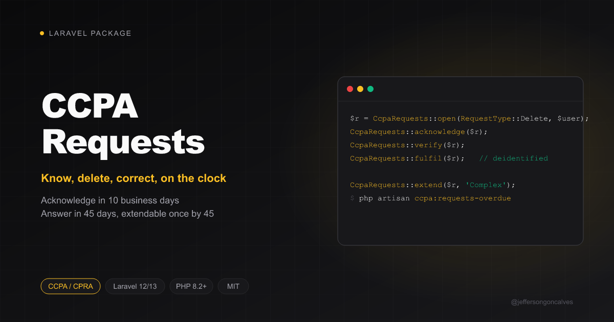

# Laravel CCPA Requests



[](https://packagist.org/packages/jeffersongoncalves/laravel-ccpa-requests)
[](https://github.com/jeffersongoncalves/laravel-ccpa-requests/actions/workflows/tests.yml)
[](https://packagist.org/packages/jeffersongoncalves/laravel-ccpa-requests)

Handles consumer requests under the California Consumer Privacy Act, as amended by the CPRA, using the personal information you declared with [laravel-ccpa](https://github.com/jeffersongoncalves/laravel-ccpa):

- tracks each request: its type (know, delete or correct, Cal. Civ. Code §§1798.105, 1798.106 and 1798.110), its status and the legal deadlines:
  - confirm receipt within **10 business days** (CCPA Regulations §7021);
  - answer within **45 calendar days**, extendable once by 45 more (§1798.130(a)(2)(A));
- requires **verification** before any export or deletion;
- **exports** every piece of personal information of the consumer, from all your models, as JSON on a private disk (right to know);
- **deletes** the consumer's information by applying each column's deidentify strategy. Columns marked `Keep` are left untouched, for the §1798.105(d) exceptions;
- fires an event for every request past its deadline.

Opting out of sale or sharing and limiting sensitive personal information don't need verification: see [laravel-ccpa-opt-out](https://github.com/jeffersongoncalves/laravel-ccpa-opt-out).

> This package gives you tooling. It does not make you compliant on its own. You still need legal review, for example to decide how you verify consumers and which requests you can deny.

## Installation

```bash
composer require jeffersongoncalves/laravel-ccpa-requests
php artisan vendor:publish --tag="ccpa-requests-migrations"
php artisan migrate
php artisan vendor:publish --tag="ccpa-requests-config"
```

## Locating a consumer's information

Models listed in `ccpa.models` (see [laravel-ccpa](https://github.com/jeffersongoncalves/laravel-ccpa)) are searched for the consumer's records:

- the consumer's own model (e.g. `User`) is found without extra code;
- every other model says how to find the records that belong to a consumer:

```php
use JeffersonGoncalves\CcpaRequests\Contracts\ResolvesConsumer;

class Order extends Model implements HasPersonalData, ResolvesConsumer
{
    use InteractsWithPersonalData;

    public static function consumerQuery(Model $subject): Builder
    {
        return static::query()->where('user_id', $subject->getKey());
    }
}
```

## Usage

```php
use JeffersonGoncalves\CcpaRequests\Enums\RequestType;
use JeffersonGoncalves\CcpaRequests\Facades\CcpaRequests;

// 1. Open: from a logged-in user, or from a web form or toll-free number (consumer unknown yet)
$request = CcpaRequests::open(RequestType::Know, $user);
$request = CcpaRequests::open(RequestType::Delete, requester: ['name' => 'Mary', 'email' => 'mary@example.com']);

// 2. Confirm receipt within 10 business days
CcpaRequests::acknowledge($request);

// 3. Verify the requester, linking the consumer if needed
CcpaRequests::verify($request, $user);

// 4a. Know / delete run automatically
CcpaRequests::fulfil($request, 'Your information is attached.');
$request->export_path; // ccpa/requests/request-1.json on the configured disk

// 4b. Correct: handle it yourself, then:
CcpaRequests::complete($request, 'Your address was corrected.');
CcpaRequests::reject($request, 'We could not verify your identity.');
```

When a request needs more time, extend it once by 45 days, within the first 45 days, and tell the consumer why:

```php
CcpaRequests::extend($request, 'Records spread over several systems.');   // due_at += 45 days
```

Lower-level helpers: `CcpaRequests::export($user)`, `CcpaRequests::exportToFile($user, 'file.json')`, `CcpaRequests::erase($user)`. `erase` runs inside a transaction.

### Events and deadlines

| Event | When |
|---|---|
| `ConsumerRequestOpened` | a request is opened. Use it to send the acknowledgement |
| `ConsumerRequestClosed` | a request is completed or denied. Use it to answer the consumer, with the export as needed |
| `ConsumerRequestOverdue` | `ccpa:requests-overdue` found an open request past its deadline |

```php
Schedule::command('ccpa:requests-overdue')->daily();
```

The command also warns about requests not acknowledged within 10 business days (`ConsumerRequest::query()->scopes('acknowledgementOverdue')`). Keep request records for 24 months (Regulations §7101).

## Testing

```bash
composer test
```

## Changelog

See [CHANGELOG](CHANGELOG.md).

## License

The MIT License (MIT). See [License File](LICENSE.md).
